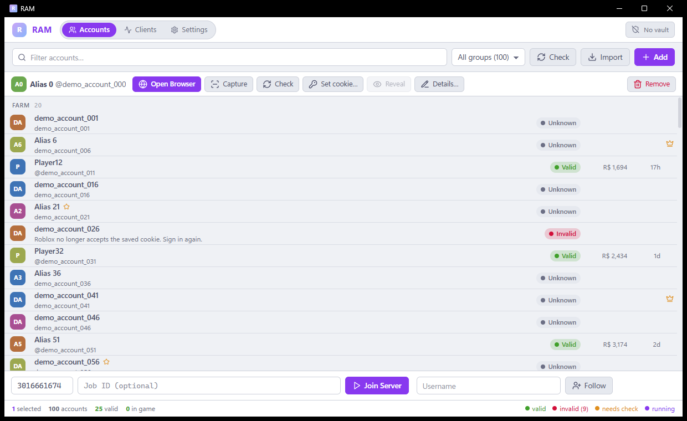

# RAM

A fast, clean Windows account manager for Roblox, built for everyday Rogue
Lineage use: switch between many accounts, join a place or follow a friend
with one click, keep every session cookie in an encrypted vault, open a
browser already signed in as any account, and run several clients at once.

RAM is a Rust rewrite of
[Roblox Account Manager](https://github.com/ic3w0lf22/Roblox-Account-Manager)
by ic3w0lf22, with a React front-end in a Tauri 2 shell. It takes its login
check from RoALT, its embedded browser model from alyae, and layout cues from
niccs' RAM v4 — see [NOTICE.md](NOTICE.md). It is not affiliated with Roblox.


## What it does

- **Accounts.** A searchable, groupable list with avatars, a Valid/Invalid
  badge, Robux and Premium, and a details pane for alias, group and notes.
- **Launch.** Type a **Place ID** (Rogue Lineage is pre-filled) and optional
  **Job ID**, select accounts, press **Join Server**. Or type a **username**
  and **Follow** them into their game. Several accounts launch one by one,
  spaced by a delay you set. Launching uses a one-time Roblox authentication
  ticket from the stored cookie — no browser round-trip.
- **Open Browser.** Opens roblox.com in a window that is already signed in as
  that account (its own browser profile, cookie injected). With no cookie
  stored yet, it shows the sign-in page: sign in there and press **Capture
  session** to save it to the vault. Navigation is limited to Roblox hosts.
- **Login check.** The RoALT method: `users.roblox.com/v1/users/authenticated`
  with the cookie. 401 means invalid; a "bound session" or verification
  challenge is reported as such; rate limits and network errors never change
  what you last knew. Rotated cookies are saved automatically.
- **Vault.** Cookies are encrypted at rest with Windows data protection
  (DPAPI) or a master password (Argon2id + AES‑256‑GCM) with auto-lock and a
  one-time recovery code. Revealing a cookie asks for Windows Hello or the
  master password.
- **Multi-instance.** On by default: RAM holds Roblox's single-instance lock
  so more than one client can run. It owns a named Windows object only; it
  does not modify or inject into the client.
- **Import / export.** Preview-first import from Roblox Account Manager's
  `AccountData.json`, optionally moving its cookies into the vault; export
  back out with or without cookies.
- **Themes.** System, Light, Dark, Catppuccin (Mocha, Macchiato, Frappé,
  Latte), Nord, Dracula, Gruvbox, Rosé Pine and a muted Lineage palette, with
  an accent colour, corner radius and compact density.
- **Two layouts.** *Modern* (above) has a sidebar and a details pane.
  *Classic* is alyae's single-list look: a top bar, one full-width list, and
  the selected account's actions in a strip. Settings → Appearance → Layout.

  
- **Clients.** A live list of running Roblox clients with memory use and a
  polite close.

## Getting started

1. Run `RAM.exe`. (Windows 10 1809+ with the WebView2 runtime, which Windows
   11 and current Windows 10 already have.)
2. **Settings → Security → Set up vault** (Windows account or master password).
3. **Add** an account, then **Open Browser**, sign in, and **Capture session**.
   Or paste a cookie with **Set cookie…**. Or **Import** from Roblox Account
   Manager.
4. Select accounts, keep the Place ID (Rogue Lineage) or type another, press
   **Join Server**.

## Keyboard

| Keys | Action |
|---|---|
| Click / Ctrl+click / Shift+click | Select / toggle / range-select accounts |
| Ctrl+A | Select all (Main excluded) |
| Enter | Join Server with the selected accounts |
| Double-click | Join Server with that account |
| Delete | Remove the selected accounts |
| Esc | Close a dialog |

## Security notes

A stored session cookie is as powerful as a password. RAM encrypts cookies at
rest and gates reveal/copy behind Windows Hello or the master password, but it
cannot protect against malware already running as your Windows user. Use the
master-password vault on shared machines, keep the recovery code offline, and
remove cookies you no longer need. Running several clients at once is not
officially supported by Roblox.

## Building

See [docs/BUILD.md](docs/BUILD.md). In short:

```powershell
.\scripts\package.ps1
```

## Documentation

- [Design decisions](docs/DECISIONS.md) · [Reference code study](docs/REFERENCE_CODE_STUDY.md)
- [Migration notes](docs/MIGRATION.md) · [Support matrix](docs/SUPPORT_MATRIX.md) · [Benchmarks](docs/BENCHMARKS.md)
- [Legacy source audit](docs/LEGACY_AUDIT.md) · [Research notes](docs/RESEARCH_NOTES.md)

## Licence

GPL-3.0-or-later. See [LICENSE](LICENSE) and [NOTICE.md](NOTICE.md). Roblox
and Rogue Lineage are trademarks of their owners; RAM is unaffiliated and does
not modify the Roblox client.
