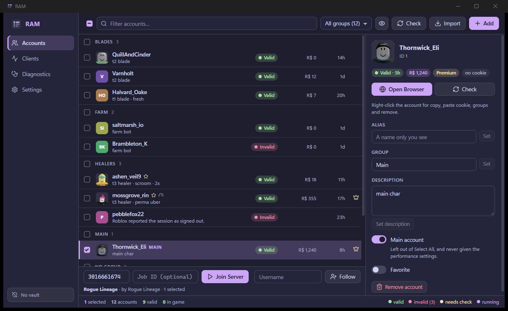
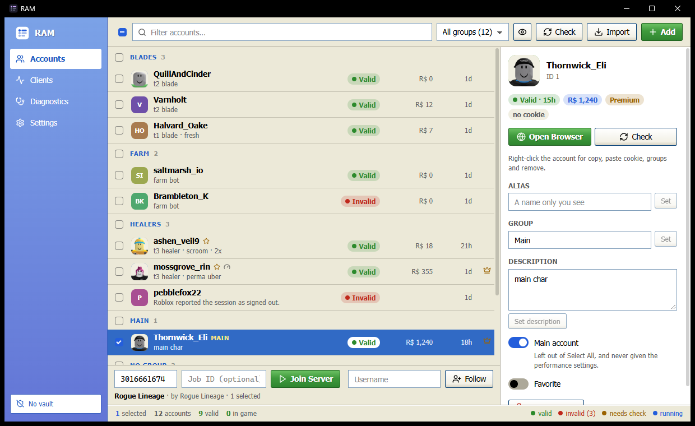
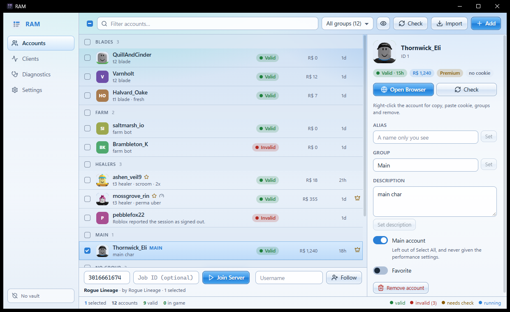
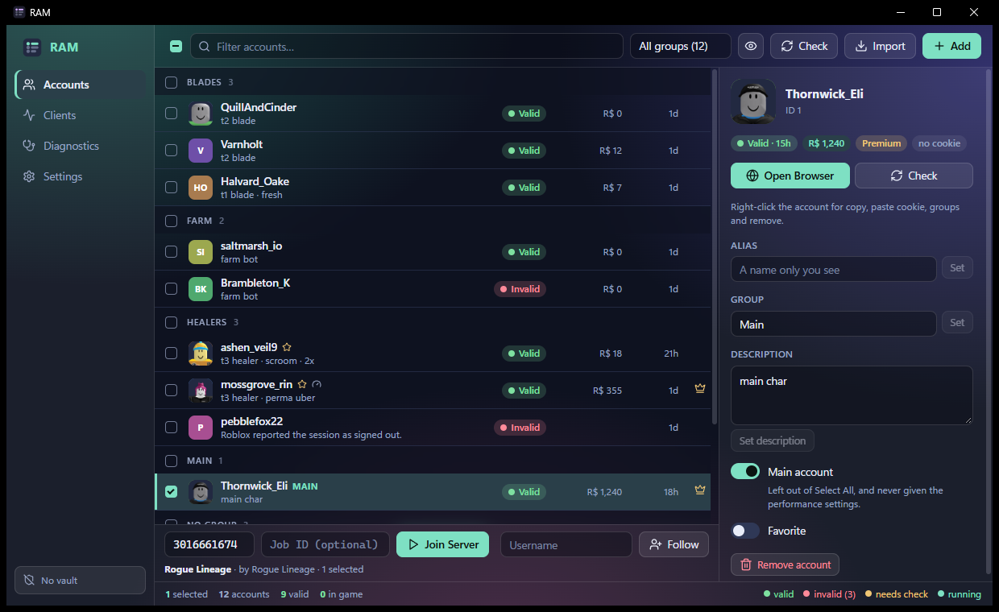
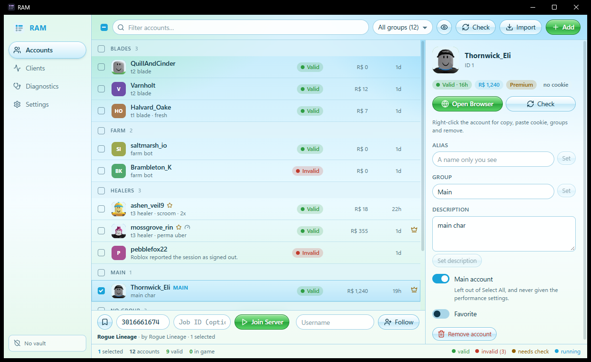
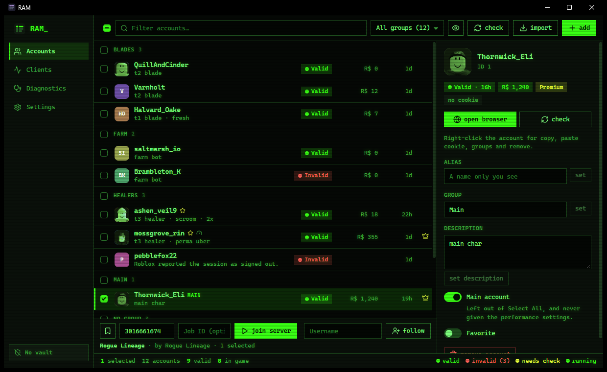
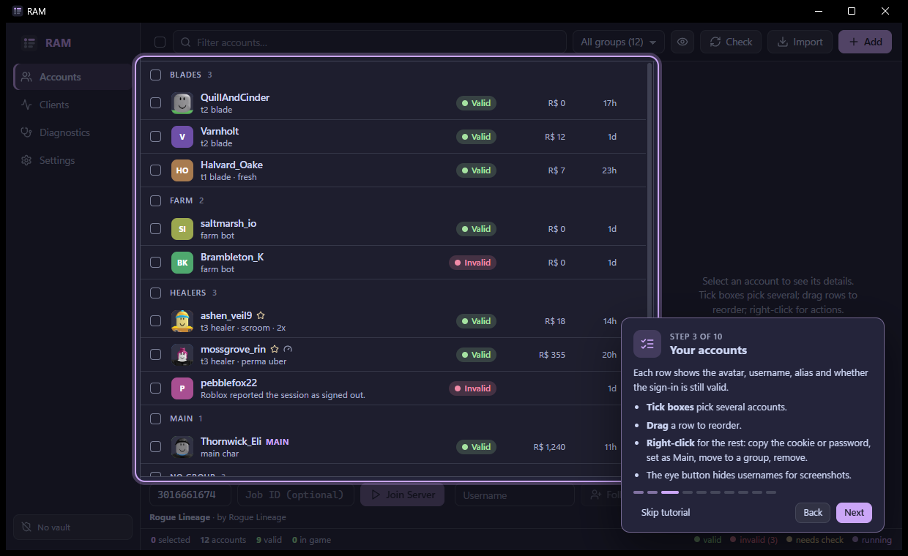
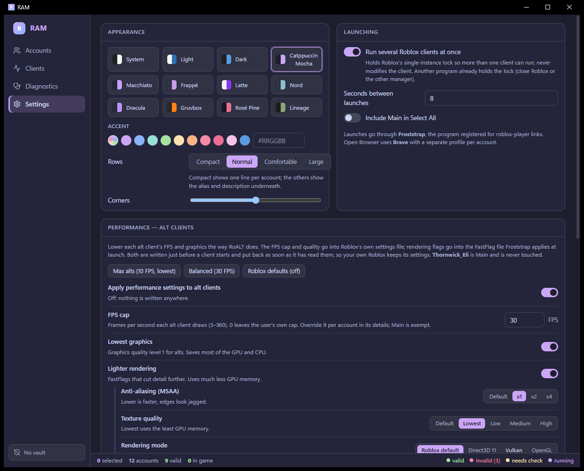
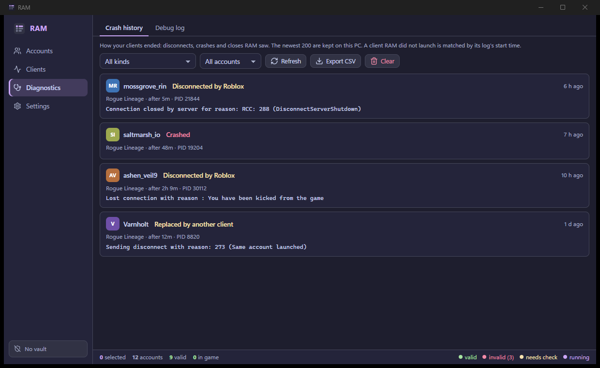

# RAM

A  very very very fast, clean Windows account manager for Roblox, built for everyday Rogue
Lineage use: switch between many accounts, join a place or follow a friend
with one click, keep every session cookie in an encrypted vault, open your
own browser already signed in as any account, run several clients at once,
and keep the alts light on your PC.


this is vibe coded!!!!!!!!! if you dont like it then i recomend using ic3wolfs account manager. this project aims to add a lot of qol while being faithful to the original. this is pretty decent for 23s and just regular use, i didnt like the old account manager because its ugly

[](https://github.com/percosz/RAM/releases/latest)
[](https://github.com/percosz/RAM/actions/workflows/release.yml)
[](LICENSE)



## Download

Go to the [latest release](https://github.com/percosz/RAM/releases/latest):

| File | Use it when |
|---|---|
| `RAM_<version>_x64-setup.exe` | You want it installed and kept up to date automatically. |
| `RAM-<version>-x64-portable.zip` | You want a single `RAM.exe` in a folder of your choice. It does not update itself. |

Windows 10 1809 or later with the WebView2 runtime (already part of Windows
11 and current Windows 10). Windows SmartScreen may warn the first time
because the installer is not code-signed with a paid certificate; the
auto-updater verifies every update against RAM's own release signature.

## What it does

- **Accounts.** A searchable, groupable list with Roblox headshots, the
  username first and your alias and description underneath, a Valid/Invalid
  badge, Robux and Premium. Each row shows whether the account is in a game
  right now (here or on another device), online, or when it was last seen
  online, checked with Roblox every 15 seconds; launching an account that is
  already playing asks first. The sidebar and details pane can be resized by
  dragging their dividers. Tick boxes on rows and group headers pick any set
  of accounts; the details pane edits alias, group and description, marks
  Main and favourites, and shows how the account was added (cookie only,
  browser sign-in, or login + password). Drag rows to reorder. One click on
  the eye button hides names, aliases, avatars, Robux and user IDs for
  screenshots and streams.
- **Add accounts your way.** Sign in with Roblox in your own browser, paste a
  cookie, or paste a list. Cookies in the list are added at once;
  `username:password` lines go into a queue: RAM opens Roblox's own sign-in
  page in your browser for one account at a time, types the login and
  presses Sign in, you solve any check, and RAM saves the session and moves
  on. Skip and Stop control the queue. Passwords can be kept in the vault
  (encrypted) and copied later.
- **Right-click menu.** For one account or the ticked selection: Join Server,
  Open Browser, Check sign-in, Copy (username, alias, user ID, profile link,
  cookie, password, `username:password`), Paste cookie, Set as Main,
  Favorite, Full quality, Move to group, Sort, Remove.
- **Launch.** Type a **Place ID** (Rogue Lineage is pre-filled; the bar shows
  the place's name) and optional **Job ID**, tick accounts, press **Join
  Server**. Or type a **username** and **Follow** them into their game.
  Several accounts launch one by one, spaced by a delay you set. Launching
  uses a one-time Roblox authentication ticket from the stored cookie, through
  whatever handles `roblox-player:` links on your PC (Roblox itself, or
  Bloxstrap, Froststrap, Fishstrap, Voidstrap).
- **Open Browser.** Opens roblox.com in your own browser (Brave, Chrome,
  Edge, Vivaldi) already signed in as that account, each account in its own
  browser profile. RAM follows the Windows default browser, or you pin one
  in Settings. With no cookie stored yet it shows the sign-in page: sign in
  there and RAM saves the session by itself, as it does when Roblox renews
  the cookie. The profile's cookies are wiped when the window closes; the
  vault stays the only store.
- **Login check.** The RoALT method: `users.roblox.com/v1/users/authenticated`
  with the cookie. 401 means invalid; a "bound session" or verification
  challenge is reported as such; rate limits and network errors never change
  what you last knew. Rotated cookies are saved automatically. A scheduled
  check (every 1 to 12 hours) can tell you which accounts need signing in
  again.
- **Vault.** Cookies and saved passwords are encrypted at rest with Windows
  data protection (DPAPI) or a master password (Argon2id + AES‑256‑GCM) with
  auto-lock and a one-time recovery code. Copying a cookie or a password
  asks for Windows Hello or the master password.
- **Multi-instance.** On by default: RAM holds Roblox's single-instance lock
  so more than one client can run. It owns a named Windows object only; it
  does not modify or inject into the client.
- **Performance for alts.** An FPS cap, lowest graphics and lighter rendering
  (MSAA, texture quality, rendering mode, gray sky, no grass, lowest render
  quality, paused lighting) plus your own FastFlags, written just before each
  alt client starts and put back once it has read them. Per-account FPS cap
  and *Full quality*; the **Main** account is never touched. Presets: Roblox
  defaults (the starting point, nothing is written), Balanced, Max alts.
  Volume 0 is an option.
- **Running clients.** Minimize on launch, tiny windows, mute, a background
  CPU limit, efficiency mode and memory trim for alt clients, all off until
  you turn them on and never applied to Main or Full quality accounts. A
  bandwidth limit is also there; it is a Windows network policy, so it asks
  for administrator approval and applies to every Roblox client on the PC.
- **Auto-rejoin.** Optional: when an alt is disconnected or crashes, RAM
  launches it again the way it last joined (same server, same place, or the
  user it followed), falling back to the place if that does not work, with
  spaced and capped attempts. Never a client you closed yourself, never Main.
- **Saved places.** A bookmark button next to the Place ID keeps your places
  one click away.
- **Clients.** Every Roblox client that is open, with its account and memory
  use; close one, or Minimize all / Restore all with one click.
- **Diagnostics.** A crash history that says how each client ended
  (disconnected, crashed, replaced, sign-in refused) with the reason from its
  log, CSV export and a link to the log. A client you close yourself is not
  recorded, including one ended with End task, and neither is a client that
  does not belong to an account in RAM. RAM's own log has level filters and
  a redacted "Copy diagnostics".
- **Import / export.** RAM searches your PC for Roblox Account Manager's
  `AccountData.json` and its backups (`.backup`, `.bak`, `.old`), unlocks the
  file if it has a password, shows a preview, and moves its cookies and saved
  passwords into the vault; export back out with or without cookies.
- **Backup and restore.** One file with your accounts, settings, cookies and
  saved passwords, encrypted with a password you choose and restorable on
  any PC.
- **Themes and rows.** Twenty-nine themes. Palettes: System, Light, Dark,
  Midnight (pure black), Catppuccin (Mocha, Macchiato, Frappé, Latte), Nord,
  Dracula, Gruvbox, Rosé Pine, Tokyo Night, One Dark, Solarized (dark and
  light), Monokai, Everforest, Sakura and a muted Lineage palette. Looks that
  restyle the whole app: Windows XP, Windows Vista (Aero glass), Classic
  (95), Frutiger Aero, Aurora, Ocean, Sunset, Synthwave and Terminal. An
  optional **window backdrop** (Mica on Windows 11, or Acrylic) lets the
  desktop show through. Plus an accent colour, corner radius, and four row
  sizes from Compact (one line) to Large.
- **Tutorial.** A one-minute tour on first launch points at each part of the
  app in turn; skip it at any step and repeat it from the bottom of Settings.
- **Updates.** RAM checks GitHub Releases when it starts and every 6 hours.
  A new version is announced in a dialog with its release notes and two
  choices, **Update now** or **Later**; Later keeps the offer in the sidebar.
  Nothing installs without your click, and the installer must carry RAM's
  release signature. The first start after an update shows what is new in
  every version since the one you had.

<details>
<summary>More screenshots</summary>

















</details>

## Getting started

1. Install RAM (or unzip the portable build) and run it. The tutorial shows
   you around the first time; skip it if you like.
2. **Settings → Security → Set up vault** (Windows account or master password).
3. **Add** an account: **Sign in with Roblox** (your browser opens, RAM saves
   the session), paste a cookie, or paste a list of cookies or
   `username:password` lines. Or **Import** from Roblox Account Manager with
   the cookie switch on.
4. Mark your own account as **Main** (details pane or right-click), then pick
   a preset in **Settings → Performance** if you want light alts.
5. Tick accounts, keep the Place ID (Rogue Lineage) or type another, press
   **Join Server**.

## Keyboard and mouse

| Keys | Action |
|---|---|
| Tick box | Add or remove one account from the selection |
| Right-click | Actions for that account or the selection: join, open browser, copy (cookie, password and more), paste cookie, groups, Main, remove |
| Drag a row | Reorder accounts; drop into another group to move it there |
| Click / Ctrl+click / Shift+click | Select / toggle / range-select accounts |
| Ctrl+A | Select all (Main excluded) |
| Enter | Join Server with the selected accounts |
| Double-click | Join Server with that account |
| Delete | Remove the selected accounts |
| Esc | Close a dialog |
| ← / → , Enter, Esc | In the tutorial: back / next, next, skip |

## Privacy and security

- RAM talks only to Roblox (login check, tickets, headshots, place names)
  and, for update checks, to GitHub. There is no telemetry.
- Everything stays in `%LOCALAPPDATA%\RAM`: `store.json` (accounts, settings,
  crash history), `vault.bin` (encrypted cookies and saved passwords),
  `browser-profiles\` and `RAM.log`. Cookies and passwords never reach the
  log or the plain data file.
- A stored session cookie is as powerful as a password. RAM encrypts cookies
  (and any passwords you choose to save) at rest and gates copying them behind
  Windows Hello or the master password, but it cannot protect against malware
  already running as your Windows user. Passwords are only ever typed into
  Roblox's own sign-in page in your browser; turn "Save passwords" off and
  they are forgotten as soon as the form is filled. Use the master-password
  vault on shared machines and keep the recovery code offline.
- Open Browser drives the browser through Chrome's DevTools protocol on a
  loopback port that only exists while that window is open; any program
  running as you could talk to that window during that time. Close it when
  you are done.
- Running several clients at once is not officially supported by Roblox. The
  performance settings use the same files Roblox and Bloxstrap use (Roblox's
  own settings XML and `ClientAppSettings.json`) and are restored after each
  launch.
- The limits for running clients only minimize, resize, mute or slow down
  client processes from the outside. The bandwidth limit is the one setting
  that changes Windows itself (a network policy named `RAM-Roblox`); remove
  it in Settings, or it goes away when the PC restarts.

## Building

See [docs/BUILD.md](docs/BUILD.md). In short:

```powershell
.\scripts\package.ps1
```

Releases are built and signed by [the Release workflow](.github/workflows/release.yml)
when a version tag is pushed.

## Documentation

- [Changelog](CHANGELOG.md) · [Design decisions](docs/DECISIONS.md) · [Reference code study](docs/REFERENCE_CODE_STUDY.md)
- [Migration notes](docs/MIGRATION.md) · [Support matrix](docs/SUPPORT_MATRIX.md) · [Benchmarks](docs/BENCHMARKS.md)
- [Legacy source audit](docs/LEGACY_AUDIT.md) · [Research notes](docs/RESEARCH_NOTES.md)

## Credits and licence

RAM is a Rust rewrite of
[Roblox Account Manager](https://github.com/ic3w0lf22/Roblox-Account-Manager)
by ic3w0lf22, with a React front-end in a Tauri 2 shell. Its login check,
performance model and crash history follow [RoALT](https://github.com/inspectsoftware/RoALT),
its browser-profile idea follows [niccs' RAM v4](https://github.com/niccsprojects/Roblox-Account-Manager)
and [alyae](https://github.com/vysaely/alyae), and its layout takes cues from
both. See [NOTICE.md](NOTICE.md) for what was taken from where.

GPL-3.0-or-later. See [LICENSE](LICENSE). Roblox and Rogue Lineage are
trademarks of their owners; RAM is not affiliated with either and does not
modify the Roblox client.
